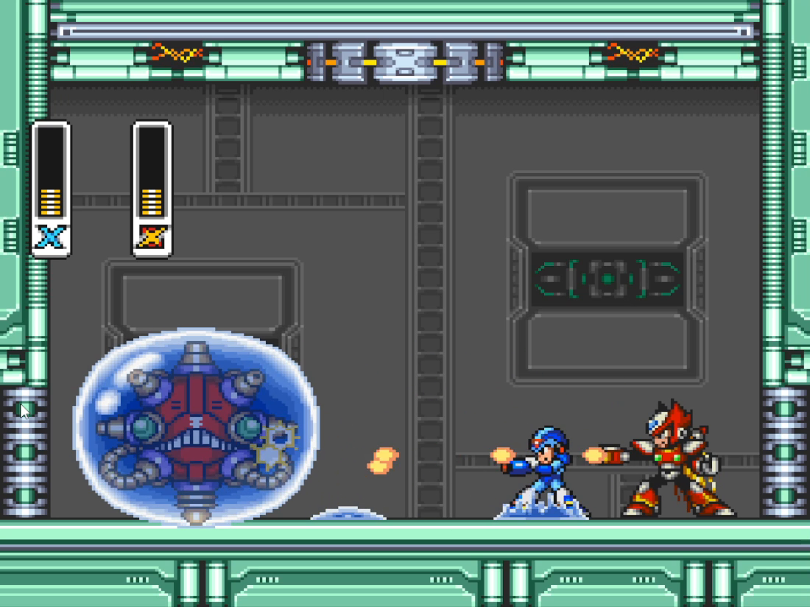
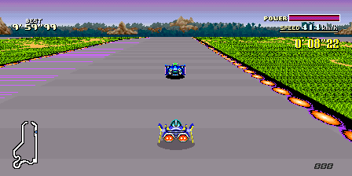
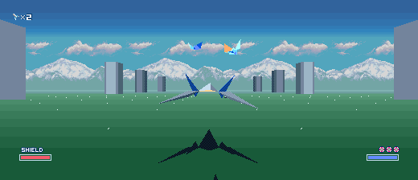
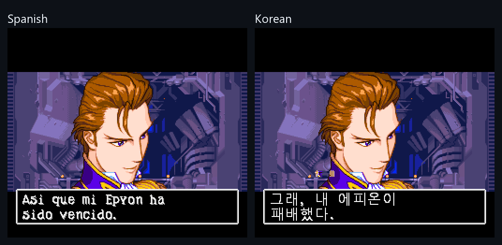
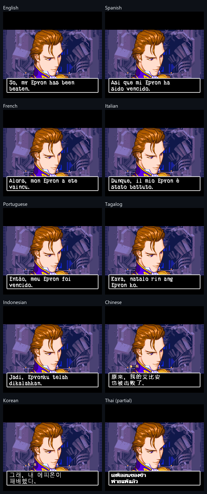

<p align="center">
  
</p>

# SNESRecomp

> ℹ️ **Note from mstan:** This repo and I are now part of [RetroPortingToolkit](https://retroportingtoolkit.com/). I remain a primary maintainer of snesrecomp alongside the team. [More info](https://1379.tech/forming-a-collective-retro-porting-toolkit/).

**A beta static-recompilation framework for the Super Nintendo and Super
Famicom.** SNESRecomp translates 65816 machine code into C and builds native
applications around a shared SNES hardware runtime. Unresolved code can run
through the interpreter tier while a port grows.

The ecosystem now includes action games, racers, fighters and RPGs, with
game-specific features such as **adaptive widescreen, local and online
co-op, rollback netplay, runtime translations, MSU-1 music, save states and
rewind**. Availability varies by title; beta describes the framework, and
each game keeps its own release and validation status.

**[Create your first port](docs/GETTING_STARTED.md)** — a practical setup and
porting guide, with no AI required. **[Choose a game](#games)** to play an
existing port with your own ROM.

## Showcase

### Mega Man X: X and Zero, together

Play X1 with **simultaneous X/Zero co-op**, locally or online. Optional mods
add playable Zero styles, a solo/co-op Boss Rush, and all sixteen X2/X3 boss
weapons with charged attacks. Zero requires your own X3 USA ROM; imported
weapons require the corresponding X2/X3 ROM. Extraction happens locally.

<p align="center">
  <a href="https://github.com/mstan/MegaManXSNESRecomp"></a>
  <br><sub><b>Mega Man X — simultaneous co-op.</b> Both characters fight in the same stage.</sub>
</p>

**Online play** uses the shared recomp-net lobby and rollback integration.
Each player configures their local controller, joins the room, and uses the
same compatible build, ROMs and mod selections. Mega Man X supports fixed
16:9, 21:9 and 32:9 views online; its window-following Adaptive mode is for
offline play. See the [X/Zero netplay guide](https://github.com/mstan/MegaManXSNESRecomp/blob/main/docs/netplay.md).

### Adaptive widescreen: more of the game world

Fit-to-window views expand the scene as the window changes shape. A complete
integration extends background streaming, sprite visibility and HUD layout;
it also handles scene edges and screens that need the original view. Games
can offer fixed ultrawide presets alongside adaptive modes.

<table>
  <tr>
    <td width="50%"><br><sub><b>Super Mario World</b> — expanded terrain and anchored HUD.</sub></td>
    <td width="50%"><br><sub><b>Super Metroid</b> — custom ultrawide composition.</sub></td>
  </tr>
  <tr>
    <td><br><sub><b>F-Zero</b> — BS Deluxe Forest III at 21:9; optional HD Mode 7 and MSU-1.</sub></td>
    <td><br><sub><b>Star Fox</b> — optional renderer adapted from <a href="https://github.com/kandowontu/Starfox-Enhanced">Starfox-Enhanced</a>.</sub></td>
  </tr>
</table>

### Gundam Wing: Endless Duel in ten translated languages

Runtime localization replaces the game's text and tile assets in memory;
the game renders the translated menus and dialogue itself. The original
Japanese ROM stays unchanged on disk.

<p align="center">
  
  <br><sub><b>Spanish and Korean.</b> Complete dialogue captured from the running game.</sub>
</p>

The localization mod offers **English, Spanish, French, Italian,
Portuguese, Tagalog, Indonesian, Chinese, Korean and Thai**, alongside the
original Japanese. **Thai is partial**: some surfaces still use English.
Translation and glyph coverage have title-specific limits.

<details>
<summary><b>See the same dialogue in all ten translated languages</b></summary>

<p align="center">
  
</p>

The Spanish panel uses a completed dialogue capture. The earlier PR contact
sheet caught another line partway through its typewriter animation. See the
[localization PR](https://github.com/TechnicallyComputers/GundamWingEndlessDuelSNESRecomp/pull/3),
[Spanish repairs](https://github.com/TechnicallyComputers/GundamWingEndlessDuelSNESRecomp/pull/6)
and [screenshot sources](docs/SHOWCASE_SOURCES.md).

</details>

## Games

These are separate projects, with their own maintainers, supported ROMs and
platforms. **A listed title is not a claim of full-game validation.** The
summaries below were checked against public project documentation and release
notes on **21 October 2026**. Follow each project's instructions; some downloads
are ready-to-play applications, while others generate and build locally on
first launch. No ROM is supplied by SNESRecomp.

| Game | Project / downloads | Features and current scope |
|---|---|---|
| *Mega Man X* | [MegaManXSNESRecomp](https://github.com/mstan/MegaManXSNESRecomp) · [downloads](https://github.com/mstan/MegaManXSNESRecomp/releases) | X/Zero local and online co-op, rollback, adaptive/offline and fixed/online widescreen, Boss Rush, X2/X3 weapons. |
| *Super Mario World* | [SuperMarioWorldRecomp](https://github.com/mstan/SuperMarioWorldRecomp) · [downloads](https://github.com/mstan/SuperMarioWorldRecomp/releases) | Adaptive widescreen with Fit to screen, MSU-1, character mods; native simultaneous co-op is experimental. |
| *The Legend of Zelda: A Link to the Past* | [ZeldaAlttPSNESRecomp](https://github.com/mstan/ZeldaAlttPSNESRecomp) · [downloads](https://github.com/mstan/ZeldaAlttPSNESRecomp/releases) | Adaptive view and MSU-1; assisted dungeon/boss-room surveys extend beyond the early-game playtest. Full campaign not certified. |
| *Super Metroid* | [SuperMetroidRecomp](https://github.com/mstan/SuperMetroidRecomp) · [downloads](https://github.com/mstan/SuperMetroidRecomp/releases) | Custom widescreen renderer with Fit/ultrawide, save states and rewind; precompiled desktop releases. |
| *F-Zero* | [FZeroSNESRecomp](https://github.com/mstan/FZeroSNESRecomp) · [downloads](https://github.com/mstan/FZeroSNESRecomp/releases) | Fit/16:9/21:9/32:9, HD Mode 7, high-refresh presentation, BS F-Zero Deluxe, MSU-1, save states and rewind. |
| *Mega Man X2* | [MegaManX2Recomp](https://github.com/mstan/MegaManX2Recomp) · [downloads](https://github.com/mstan/MegaManX2Recomp/releases) | Cx4 support and optional 16:9 with widened backgrounds, objects and HUD; stage-entry survey, wider gameplay validation ongoing. |
| *Mega Man X3* | [MegamanX3SNESRecomp](https://github.com/mstan/MegamanX3SNESRecomp) · [downloads](https://github.com/mstan/MegamanX3SNESRecomp/releases) | Cx4 support, gameplay and optional 16:9; original stage loaders surveyed, full campaign validation ongoing. |
| *Star Fox* | [StarFoxSNESRecomp](https://github.com/mstan/StarFoxSNESRecomp) · [downloads](https://github.com/mstan/StarFoxSNESRecomp/releases) | Development preview: optional Enhanced adaptive/ultrawide renderer and Arwing 64 mod. Single-player. |
| *Super Mario RPG* | [SuperMarioRPGRecomp](https://github.com/mstan/SuperMarioRPGRecomp) · [downloads](https://github.com/mstan/SuperMarioRPGRecomp/releases) | SA-1 preview; optional adaptive custom field renderer. Attract/scene checks do not establish a full playthrough. |
| *Gundam Wing: Endless Duel* | [GundamWingEndlessDuelSNESRecomp](https://github.com/TechnicallyComputers/GundamWingEndlessDuelSNESRecomp) · [downloads](https://github.com/TechnicallyComputers/GundamWingEndlessDuelSNESRecomp/releases) | Optional widescreen, ten runtime translations (Thai partial) and rollback-capable netplay; assisted story-through-credits validation. |
| *SimCity / Urban Recomp* | [UrbanRecomp](https://github.com/blackerking/UrbanRecomp) · [downloads](https://github.com/blackerking/UrbanRecomp/releases) | Adaptive widescreen/Fit, language selection, save states and city/scenario tooling; Windows and Linux releases. |

### Community game projects

Independent projects may use their own framework branches and host designs.
Their maintainers' status reports apply to those builds, rather than to
every SNESRecomp revision. Projects with limited testing are included so
contributors can find the work as well as the downloads.

| Game | Project | Features and current scope |
|---|---|---|
| *ActRaiser* | [ar-recomp](https://github.com/DerrickGold/ar-recomp) · [downloads](https://github.com/DerrickGold/ar-recomp/releases) | Campaign completed by the maintainer; widescreen, optional 3D presentation, replacement media and language-pack Workshop. |
| *A.S.P.: Air Strike Patrol* | [A.S.P._SNES_Recomp](https://github.com/SirL0LL0/A.S.P._SNES_Recomp) | Italian translation and native-code work; briefing, HQ and mission-one flight validation. |
| *Demon’s Crest* | [DemonsCrestSNESRecomp](https://github.com/magnopaz/DemonsCrestSNESRecomp) | Adaptive widescreen, Mode 7 overworld, save states and rewind; full-game certification remains open. |
| *Donkey Kong Country* | [DKC1Recomp](https://github.com/elliotttate/DKC1Recomp) · [downloads](https://github.com/elliotttate/DKC1Recomp/releases) | Widescreen, controller/settings UI and save tools; platform-specific presentation and music options. |
| *Donkey Kong Country 2* | [DKC2Recomp](https://github.com/elliotttate/DKC2Recomp) · [downloads](https://github.com/elliotttate/DKC2Recomp/releases) | Experimental widescreen; Windows simultaneous TEAM co-op and MSU-1. The older Mac build has a smaller feature set. |
| *Donkey Kong Country 3* | [DKC3Recomp](https://github.com/elliotttate/DKC3Recomp) · [downloads](https://github.com/elliotttate/DKC3Recomp/releases) | Widened presentation and modern desktop hosts; optional macOS MSU-1. Full-game compatibility remains under test. |
| *Doom* | [DoomSNESRecomp](https://github.com/Cacodemontube/DoomSNESRecomp) · [downloads](https://github.com/Cacodemontube/DoomSNESRecomp/releases) | Adaptive world rendering, higher internal resolutions, interpolated presentation and modern mouse controls. |
| *EarthBound* | [EarthBoundRecomp](https://github.com/nickclyde/EarthBoundRecomp) | Early HiROM bring-up: intro, title and file select through the interpreter tier. |
| *Final Fantasy V* | [FinalFantasyVSNESRecomp](https://github.com/brainWave4/FinalFantasyVSNESRecomp) · [downloads](https://github.com/brainWave4/FinalFantasyVSNESRecomp/releases) | Japanese-ROM port with launcher and a Linux AppImage; battle-character controller assignment. |
| *Final Fight 3* | [Final-Fight-3-Recomp](https://github.com/omegakatana92/Final-Fight-3-Recomp) · [downloads](https://github.com/omegakatana92/Final-Fight-3-Recomp/releases) | Windows bring-up: launcher, graphics, audio and gameplay locally tested. |
| *Go Go Ackman* | [gogoackman1recomp](https://github.com/catmidori/gogoackman1recomp) · [downloads](https://github.com/catmidori/gogoackman1recomp/releases) | Widescreen, English/Brazilian Portuguese translations, save states, rewind, shaders and rumble; MSU-1 is unverified. |
| *Goof Troop* | [GoofTroopRecomp](https://github.com/willianpn01/GoofTroopRecomp) | Linux/Windows frontend, two local players, remapping and display filters; pre-publication review described by the maintainer. |
| *Harvest Moon* | [HarvestMoonSNESRecomp](https://github.com/RodriLoy/HarvestMoonSNESRecomp) · [downloads](https://github.com/RodriLoy/HarvestMoonSNESRecomp/releases) | Beta: widescreen, expanded pause menu, calendar/map and quality-of-life mods; full three-year route unverified. |
| *International Superstar Soccer Deluxe* | [issd-native](https://github.com/sergiomanzur/issd-native) · [downloads](https://github.com/sergiomanzur/issd-native/releases) | Beta builds, four local players, experimental widened camera, campaign recovery and stadium tools; netplay is planned. |
| *Kirby Super Star* | [KirbySuperStarRecomp](https://github.com/josiahg2502-glitch/KirbySuperStarRecomp) · [downloads](https://github.com/josiahg2502-glitch/KirbySuperStarRecomp/releases) | Windows frontend with widescreen, bezel art, XInput profiles and isolated saves. |
| *Lagoon* | [LagoonSNESRecomp](https://github.com/rages4calm/LagoonSNESRecomp) | Source project with custom scene rendering, experimental widescreen and escort/quality-of-life improvements. |
| *The Lion King* | [TLKRecomp](https://github.com/kinduff/TLKRecomp) · [downloads](https://github.com/kinduff/TLKRecomp/releases) | Desktop releases, experimental adaptive widescreen, practice tools and replay/conformance evidence. |
| *Lufia & the Fortress of Doom / Estpolis Denki* | [Estpolis-Recompendium](https://github.com/dothacktranslate/Estpolis-Recompendium) | Lufia I USA runtime, graphics, audio and input work; Japanese/regional and Lufia II integration are planned. |
| *Lufia II: Rise of the Sinistrals* | [Lufia2SNESRecomp](https://github.com/Cellenseres/Lufia2SNESRecomp) | Gameplay, battles, audio and saves; widened presentation and SDL/OpenGL/Vulkan output. |
| *The Magical Quest Starring Mickey Mouse* | [MagicalQuest-SNES-Recomp](https://github.com/RetroForgeBR/MagicalQuest-SNES-Recomp) · [downloads](https://github.com/RetroForgeBR/MagicalQuest-SNES-Recomp/releases) | Early desktop release; built and launched locally at original 4:3, further testing ongoing. |
| *Mario Paint* | [mariopaint](https://github.com/sp00nznet/mariopaint) | Experimental interception-based port: native mouse, title/canvas/toolbars; drawing and secondary modes need broader checks. |
| *Mario is Missing!* | [marioismissing](https://github.com/sp00nznet/marioismissing) | Compiled castle-loop prototype; this is not a completed geography adventure. |
| *Mega Man 7* | [Mega-Man-7-Recomp](https://github.com/omegakatana92/Mega-Man-7-Recomp) · [downloads](https://github.com/omegakatana92/Mega-Man-7-Recomp/releases) | Windows release with ROM-verifying launcher and desktop video/audio/input; broader gameplay qualification ongoing. |
| *Phalanx* | [phalanx](https://github.com/navjack/phalanx) | Apple Silicon source project with native gamepad integration, overlay and save-state tools. |
| *Rock N’ Roll Racing* | [RockNRollRacingSNESRecomp](https://github.com/fulalas/RockNRollRacingSNESRecomp) · [downloads](https://github.com/fulalas/RockNRollRacingSNESRecomp/releases) | Fit/ultrawide racing, optional faster game logic and interpolation, shaders, rewind and MSU-1. |
| *Star Ocean* | [StarOceanSNESRecomp](https://github.com/SupraBT/StarOceanSNESRecomp) | Early-game native port using title-specific S-DD1 work; generation and broader compatibility remain in development. |
| *Strike Gunner S.T.G.* | [Strike-Gunner-STG-Recomp](https://github.com/SlippyGetBackHere/Strike-Gunner-STG-Recomp) · [downloads](https://github.com/SlippyGetBackHere/Strike-Gunner-STG-Recomp/releases) | Maintainer reports start-to-finish play; local two-player, replacement music and optional gameplay mods. No netplay. |
| *Stunt Race FX* | [stuntrace](https://github.com/sp00nznet/stuntrace) | Early Super FX bring-up: Nintendo logo followed by a black screen; not currently playable. |
| *Super Bomberman* | [BombermanRecomp](https://github.com/elliotttate/BombermanRecomp) · [downloads](https://github.com/elliotttate/BombermanRecomp/releases) | Windows recompilation with measured native-cadence frame pacing and gameplay checks. |
| *Super Bomberman 5* | [SuperBomberman5SNESRecomp](https://github.com/MauricioSuporte/SuperBomberman5SNESRecomp) · [downloads](https://github.com/MauricioSuporte/SuperBomberman5SNESRecomp/releases) | Partial-recomp prototype with five-player Normal Game mods; campaign tested, physical five-controller qualification pending. No netplay/widescreen. |
| *Super Castlevania IV* | [SuperCastlevaniaIvSNESRecomp](https://github.com/RasmusKarlsson/SuperCastlevaniaIvSNESRecomp) | Playable source project with optional 16:9, save states and rewind; wider Mode 7/boss coverage ongoing. |
| *Super Castlevania IV (alternate project)* | [SuperCastlevaniaIVRC](https://github.com/B1gGiantB8by/SuperCastlevaniaIVRC) · [downloads](https://github.com/B1gGiantB8by/SuperCastlevaniaIVRC/releases) | Setup packs, Boss Rush, level select, local achievements and experimental MSU-1; ordinary releases keep widescreen disabled. |
| *Super Dimension Fortress Macross: Scrambled Valkyrie* | [Super-Dimension-Fortress-Macross-Scrambled-Valkyrie-Recomp](https://github.com/omegakatana92/Super-Dimension-Fortress-Macross-Scrambled-Valkyrie-Recomp) · [downloads](https://github.com/omegakatana92/Super-Dimension-Fortress-Macross-Scrambled-Valkyrie-Recomp/releases) | Windows development project; local gameplay tests reported, fresh-clone reproduction not independently qualified. |
| *Super Mario All-Stars* | [SuperMarioAllStarsRecomp](https://github.com/TanookiStudios/SuperMarioAllStarsRecomp) · [downloads](https://github.com/TanookiStudios/SuperMarioAllStarsRecomp/releases) | USA collection: four games, desktop releases, controller-friendly launcher and in-game menu. |
| *Super Mario All-Stars (CollectionRecomp)* | [CollectionRecomp](https://github.com/SatellaGuyAlt/CollectionRecomp) · [downloads](https://github.com/SatellaGuyAlt/CollectionRecomp/releases) | Japanese collection prototype with launcher and experimental widescreen. |
| *Super Mario Kart* | [SuperMarioKartRecomp](https://github.com/Zaxaerith/SuperMarioKartRecomp) | Source port with launcher and local racing/Battle mode. See also the independent projects below. |
| *Super Tennis* | [SuperTennisRecomp](https://github.com/craigshaw/SuperTennisRecomp) | Windows/macOS source build, one/two local players, remapping and settings; complete matches tested. |
| *Super Mario World 2: Yoshi’s Island* | [SuperMarioWorld2YoshisIslandRecomp](https://github.com/Zaxaerith/SuperMarioWorld2YoshisIslandRecomp) | Source project with desktop launcher, intro/title and stage gameplay; broad campaign validation not established. |
| *Smash Tennis* | [Smash-Tennis-Restrung](https://github.com/dpanchekha/Smash-Tennis-Restrung) | Decompilation/network-play development project; no completed-playability claim. |
| *Uniracers* | [uniracers-recomp](https://github.com/baldosa/uniracers-recomp) · [downloads](https://github.com/baldosa/uniracers-recomp/releases) | Native desktop/browser builds, two-player routes and browser online play; maintains a framework branch. |

Other takes on existing titles include [Super Mario Kart / mk](https://github.com/sp00nznet/mk)
(TCP lockstep multiplayer), [NeoSMK](https://github.com/crusader290/NeoSMK)
(widescreen, full-screen solo races and optional 3D scenery), and
[F-Zero Recomp](https://github.com/craigshaw/FZeroRecomp)
(ultrawide and platform-native visual filters).

Platform adaptations include [DKC on Apple TV](https://github.com/joeblack2k/DKCRecompTV),
[DKC2 on Android](https://github.com/deivid22srk/DKC2-Android-Port),
[DKC2 on Switch](https://github.com/1weell/DKC2Recomp-Switch),
[Mega Man X on Switch](https://github.com/Thorhax/MegaManX-NX),
[Mega Man X on Xbox](https://github.com/Team-Resurgent/MegaManX-X),
[F-Zero on Vita](https://github.com/rameauv/FZeroRecomp-vita), and
[Super Metroid on DS](https://github.com/linuxkafe/SuperMetroidDS).
Consult those projects for their own setup and feature limits.

### Additional development targets

Work also exists on **BS F-Zero Grand Prix 2, Illusion of Gaia, Metal
Warriors, Super Mario Kart and Yoshi’s Island** in companion development
projects without public releases. These are separate from the public
community projects above. A development target does not imply a downloadable
or fully validated port.

To add a project, send its public repository, supported ROM identity,
implemented features and current testing limits. Keep planned features
separate from available ones.

## ROM compatibility

SNESRecomp is not a drop-in emulator: support in this table means that the
analyzer and shared runner understand the cartridge mapping or enhancement
chip. Each game still needs its own analysis configuration, integration, and
validation before it becomes a playable native port. The companion game
repositories are authoritative for supported ROM regions and revisions.

| Cartridge mapping or chip | Status | Notes |
|---|---|---|
| Standard LoROM and FastROM | **Supported** | ROM and battery-backed SRAM mapping are implemented. Headerless `.sfc` and copier-headered `.smc` images are accepted. |
| Standard HiROM and FastROM | **Supported** | ROM and battery-backed SRAM mapping are implemented and detected automatically. |
| Capcom Cx4 / CX4 | **Supported** | Instruction-level support for the chip used by *Mega Man X2* and *Mega Man X3*. Its internal data ROM is synthesized and does not require a separate firmware file. See [`runner/src/snes/CX4_NOTES.md`](runner/src/snes/CX4_NOTES.md). |
| Nintendo Super FX / GSU | **Supported** | Instruction-level core and cartridge mapping are implemented. *Star Fox* is the current development validation target; other Super FX games have not yet been qualified individually. |
| Nintendo DSP-1 / DSP-1B | **Supported** | Supported game: Super Mario Kart. Its canonical SHVC-1K1X windows, an instruction-level NEC uPD7725 core, and a firmware-free command model for the firmware-verified command set are implemented. Select `SNESRECOMP_DSP1_IMPL=LLE` (default, requires firmware) or `HLE` at build time; firmware presence never changes that choice. HLE stops loudly on an unverified command. See [DSP-1 builds and contract](docs/DSP1_IMPLEMENTATIONS.md). Prior backend evidence includes unit and differential command gates, a deterministic one-player race matching Snes9x WRAM/DSP behavior and framebuffer output within renderer rounding, and canonical 36,000-frame LLE/HLE attract qualifications. A title-gated Fast HiROM mapping supports converted development derivatives without broadening detection to other NEC DSP boards. |
| Nintendo SA-1 | **Supported** | Supported game: Super Mario RPG. Instruction-level 65816 execution, ROM-bus arbitration, Super MMC banking, IRAM/BW-RAM and bitmap windows, CPU/SA-1 interrupt communication, timers, DMA/character conversion, arithmetic, and variable-bit reading are implemented. The focused hardware suite and the canonical US 18,000-frame attract-loop qualification pass without runtime, logic-activity, video-activity, or audio-activity failures. See [`runner/src/snes/SA1_NOTES.md`](runner/src/snes/SA1_NOTES.md). |
| MSU-1 | **Supported, opt-in** | The extension's registers, data channel, and PCM audio are implemented, but a game must integrate an MSU-1 driver and pack selection. See [`docs/MSU1.md`](docs/MSU1.md). |
| ExLoROM, ExHiROM, and other custom mappings | **Not supported yet** | The current mapper layer handles standard LoROM, HiROM, SA-1, Cx4, and Super FX layouts only. |
| Nintendo DSP-2, DSP-3, and DSP-4 | **Not supported yet** | These cartridge DSP firmwares use the same NEC family interface but need per-title board/firmware validation before being advertised. |
| S-DD1 | **Experimental** | Cartridge register/MMC mapping and decompression hooks are present for Star Ocean validation. Treat as title-gated until provenance, savestate, and cross-title behavior are reviewed. |
| SPC7110 and SPC7110 RTC | **Not supported yet** | No data-decompression, mapping, or RTC model is present. |
| OBC-1, ST010, ST011, ST018, and S-RTC | **Not supported yet** | Their register windows and coprocessor behavior are not modeled. |
| BS-X, Sufami Turbo, and Super Game Boy cartridge adapters | **Not supported yet** | Their special cartridge or subsystem behavior is outside the current mapper model. |

Chips and mapping schemes not listed as supported should be assumed
unsupported. Some unsupported cartridges may get far enough through header
detection to load as a plain LoROM or HiROM image, but their unmodeled register
windows will still prevent correct execution.

## What it is

SNESRecomp turns a ROM into a recompilation project:

1. The analyzer discovers code, follows control flow, tracks the 65816 M/X
   width state, and resolves direct and indirect dispatch where it can.
2. The emitter translates discovered 65816 functions into portable C.
3. A normal C compiler builds that output together with the shared runner and
   game-specific integration code.
4. At runtime, unresolved or dynamically reached code can fall through to the
   interpreter tier instead of becoming a correctness hole.

This is a hybrid low-level design. The original game logic remains the source
of truth: recompiled CPU code drives modeled SNES hardware at the same
register boundaries a cartridge uses. Game projects can add narrowly scoped
high-level helpers or presentation enhancements, but the low-level path stays
available for validation.

SNESRecomp is a **framework**, not a collection of ROMs. It does not include
copyrighted game data, and a generated project is only the starting point for
a playable port. A new title still needs accurate function boundaries,
indirect-dispatch configuration, validation, and a host application.

## Widescreen and Adaptive View

View width and pixel shape are separate settings. The shared desktop policy
supports 4:3 CRT presentation, 8:7 square pixels and a square frame. Games
integrate their own widened view; the default authentic view remains available.

<table>
  <tr>
    <td width="32%"><br><sub><b>Original view</b></sub></td>
    <td width="68%"><br><sub><b>Adaptive View</b></sub></td>
  </tr>
</table>

The [widescreen integration checklist](docs/WIDESCREEN_PATTERNS.md) covers
backgrounds, object windows, sprites, HUD and scene boundaries. Optional
[HD Mode 7](docs/HD_MODE7.md) improves background sampling in supported
renderers independently of view width.

## Mods

Want to make a mod by hand? Start with
[`snesmod.md`](snesmod.md), including a first plugin, packaging, installation,
and testing. Existing ROM-hack features should be reimplemented as mods against
the stock ROM; recompiling patched ROMs is deprecated.

SNESRecomp supports opt-in, versioned `.snesmod` packages. A package is an
installation, update, provenance, and trust boundary; it may expose multiple
independently toggleable features and typed options in the launcher.

Packages contain data only—never DLLs or arbitrary native code. Native behavior
is owned by the game, statically linked into its executable, and registered
under stable plugin IDs. Before launch, the runtime verifies the selected stock
ROM, resolves enabled features, rejects missing or conflicting plugins, and
then activates the trusted game-side implementations.

The system is off by default at the framework level, so a game must explicitly
enable and integrate it. Mega Man X uses this path for its built-in
true-widescreen feature. See
[`docs/MOD_PACKAGES.md`](docs/MOD_PACKAGES.md) for the package format and trust
model.

Runtime localization uses the same data-only mod boundary for language-gated
ROM, RAM, and VRAM patches. See
[`docs/RUNTIME_LOCALIZATION.md`](docs/RUNTIME_LOCALIZATION.md).

## MSU-1 audio

The shared runner implements the MSU-1 registers, data channel, and 44.1 kHz
stereo PCM streaming mixed over the S-DSP output. SMW and ALttP integrate this
with their launchers: select a compatible music-pack folder and keep using a
verified stock ROM.

Their MSU-1 drivers are compiled into the executable from a temporary,
locally-patched analysis image during regeneration. The user's stock ROM is
not modified. With no pack selected, the games retain their authentic SPC
soundtracks.

The chip is inert by default for projects that do not integrate it. Developers
can also point `SNESRECOMP_MSU1` at a pack directory or base prefix directly.
See [`docs/MSU1.md`](docs/MSU1.md) for the register model, pack resolution, and
game-integration details.

## Getting started

**Creating a new port?** Follow [Your first SNESRecomp port](docs/GETTING_STARTED.md).
It walks through one Windows setup, ROM verification, scaffolding, generation,
building and the first game-specific investigation. No AI is required.

For an existing title, use its pinned dependencies and regeneration script;
do not scaffold over its repository. Developers can then use these references
as needed:

- [Project setup and porting](docs/GAME_PROJECT_SETUP.md).
- [Scaffolder options and other host platforms](tools/new_project/README.md).
- [Released CLI](https://github.com/RetroPortingToolKit/snesrecomp/releases)
  and [headless code-generation SDK](docs/LOCAL_CODEGEN_SDK.md).
- [SDL3 default and SDL2 compatibility builds](docs/SDL_BACKENDS.md).
- [Writing mods](snesmod.md) and [content-variant internals](docs/CONTENT_VARIANTS.md).

A content variant is a title-integrated program/content selection with
explicit compatibility and save rules. It does not turn an arbitrary patched
ROM into a supported port. Start with one verified stock revision.

## Architecture

| Path | Purpose |
|---|---|
| `recompiler/` | Python reference analyzer and authoritative C emitter. |
| `recompiler-rs/` | Production native whole-program analyzer; preserves the Python manifest/emitter boundary while accelerating analysis. |
| `runner/` | Shared CPU state, memory map, hardware model, interpreter tier, launcher helpers, diagnostics, and enhancement hooks. |
| `tests/` | Analyzer, decoder, interpreter, runtime-dispatch, launcher, and PPU tests. |
| `fuzz/` | Differential fuzzing over synthetic 65816 programs. |
| `tools/` | Generation, validation, trace-diff, and release tooling, including the `snesref` reference frontend. |

Useful technical references:

- [`docs/FRAME_MODEL_HOSTS.md`](docs/FRAME_MODEL_HOSTS.md) - integration notes
  for hosts that drive their own frame or beam loop.

- [`docs/MULTI_TIER.md`](docs/MULTI_TIER.md) — static and interpreted execution
  tiers.
- [`docs/LLE_FIRST_ANALYSIS.md`](docs/LLE_FIRST_ANALYSIS.md) — analysis policy
  and the low-level correctness floor.
- [`docs/HLE_FUNC.md`](docs/HLE_FUNC.md) — replacing a recompiled routine
  with a C function (`hle_func`) and the helper's stack, flag and timing
  contract.
- [`docs/TRIPWIRES.md`](docs/TRIPWIRES.md) — runtime checks for M/X state,
  dispatch, and control-flow failures.
- [`docs/LAUNCHER_DESIGN.md`](docs/LAUNCHER_DESIGN.md) — shared launcher
  integration.
- [`docs/HOST_OVERLAY_EXTRACTION.md`](docs/HOST_OVERLAY_EXTRACTION.md) —
  extracting PPU layers for host-side composition.

## Reference debugging

SNESRecomp has two complementary reference paths. Both are developer tools and
are excluded from release packages and normal game builds.

| Tool | Reference boundary | Best use |
|---|---|---|
| [`tools/snesref/`](tools/snesref/) | Loads an independently developed bsnes, Snes9x, or other libretro core at runtime. | Validate framebuffer output, audio, inputs, frame timing, and memory behavior without sharing SNESRecomp's device implementation. |
| [`cosim/ref_driver.c`](cosim/ref_driver.c) + [`tools/snes_cosim.py`](tools/snes_cosim.py) | Runs `interp816` in a separate process against the same runner devices and exposes the same `SNES_COSIM_PORT` TCP protocol as a recompiled co-sim target. | Find the first CPU/runtime divergence with full-state and per-subsystem hashes. |

Use `snesref` when the symptom could be in a shared PPU, APU, cartridge, or
coprocessor model. Use the TCP co-simulation path to localize a difference
between recompiled 65816 execution and interpreted execution. A clean internal
co-sim is not proof that rendering or audio matches hardware because both sides
intentionally share those device implementations.

### Independent libretro reference

Build the small SDL2 frontend, then provide an emulator core DLL and a legally
obtained ROM at runtime:

```powershell
cd tools\snesref
.\build.bat

$env:SNESREF_FAST = "1"
$env:SNESREF_FRAMES = "1800"
$env:SNESREF_TRACE_FILE = "wram.jsonl"
$env:SNESREF_WAV = "reference.wav"
.\snesref.exe C:\cores\bsnes_libretro.dll C:\roms\game.sfc
```

For reproducible gameplay, set `SNESREF_INPUT_FILE` to a text file containing
`start-frame:duration:hex-mask`, one event per line. The mask layout is
`B,Y,Select,Start,Up,Down,Left,Right,A,X,L,R` from bit 0 through bit 11. Frame
dumps are controlled by `SNESREF_FRAME_DUMP_DIR` and the optional
`SNESREF_FRAME_DUMP_FROM`, `_TO`, and `_STEP` variables. See
[`tools/snesref/README.md`](tools/snesref/README.md) for the complete capture
interface.

The frontend source and MIT-licensed `libretro.h` are tracked. Emulator cores,
SDL binaries, ROMs, firmware, captures, and `snesref.exe` are not tracked or
included in releases. In particular, bsnes is GPLv3 and Snes9x has a
non-commercial license; developers supply either one separately.

### Internal TCP co-simulation

The reference-only target does not need a game checkout:

```powershell
cmake -S cosim -B build\cosim-ref -G Ninja `
  -DSNES_COSIM_REF_ONLY=ON `
  -DCMAKE_BUILD_TYPE=RelWithDebInfo `
  -DCMAKE_C_COMPILER=C:/msys64/mingw64/bin/gcc.exe `
  -DCMAKE_MAKE_PROGRAM=C:/msys64/mingw64/bin/ninja.exe
cmake --build build\cosim-ref --target smw_cosim_ref

.\build\cosim-ref\smw_cosim_ref.exe C:\roms\game.sfc `
  --frames 1800 --final-frame-dump reference.raw
```

Despite its historical target name, `smw_cosim_ref` is the game-neutral
interpreter side. For lockstep comparison, build the game-specific A-side
co-sim target and let the coordinator launch both processes:

```powershell
python tools\snes_cosim.py `
  --a-cmd "build/cosim/smw_cosim.exe C:/roms/smw.sfc" `
  --b-cmd "build/cosim/smw_cosim_ref.exe C:/roms/smw.sfc" `
  --stride 1 --max 3600
```

The coordinator injects separate `SNES_COSIM_PORT` values, advances both
servers at deterministic checkpoints, and stops at the first full-state
divergence. Run the A-vs-A, B-vs-B, fault-injection, and hash-audit gates in
[`SNES_COSIM.md`](SNES_COSIM.md) before trusting an A-vs-B result.

## Status

SNESRecomp is **beta software**. Multiple game projects use the shared
framework for native desktop releases and substantial enhancements. APIs,
generated-code conventions and integration points can still change, so game
projects pin framework revisions. Per-game maturity varies; the [Games](#games)
table and each project's current release notes describe its own scope.

The current direction is to move recurring fixes into the framework, retain
an exact low-level fallback for uncertain code, and keep authentic output as
the regression baseline for every optional enhancement.

## Contributing

Bug reports and framework improvements are welcome. For a game-specific issue,
open it in that game's repository and include the ROM revision, platform,
configuration, reproduction steps, and a screenshot or save state when useful.

When bringing up a new game, keep game-specific addresses and behavior in its
companion repository. Reusable CPU, mapper, coprocessor, diagnostics, launcher,
and presentation mechanisms belong here.

## Acknowledgements

SNESRecomp did not start from scratch. Its runtime and tooling stand on prior
reverse-engineering and emulation work:

- **[snesrev](https://github.com/snesrev)** (`snesrev/zelda3`,
  `snesrev/smw`) — the C runner and surrounding ecosystem were heavily based
  on the snesrev reverse-engineered ports. The model of recompiling or porting
  CPU code to C, modeling the surrounding silicon, and validating against a
  reference emulator comes from that work. Runtime utilities, ROM verification,
  function-boundary conventions, and the default input layout were also
  adapted from it.
- The C SNES hardware core under
  [`runner/src/snes/`](runner/src/snes/) derives from
  **[LakeSnes](https://github.com/elzo-d/LakeSnes)** by elzo-d, as vendored by
  snesrev, with individual algorithms credited inline to **snes9x**.
- **[IsoFrieze/SMWDisX](https://github.com/IsoFrieze/SMWDisX)** — the Super
  Mario World disassembly used as the symbol and RAM-map basis and as a
  conformance reference. SMWDisX in turn credits mikeyk's original 2013
  disassembly and loveemu's SPC700 work.

## License

SNESRecomp's original code is licensed under the
[PolyForm Noncommercial License 1.0.0](LICENSE). Copyright © 2026 Matthew
Stanley; commercial licensing inquiries go to him at <https://1379.tech>.
Third-party components retain their own licenses as documented in
[Acknowledgements](#acknowledgements) and
[`THIRD_PARTY_ATTRIBUTION.md`](THIRD_PARTY_ATTRIBUTION.md). The `snesref` tool
loads a separately supplied libretro emulator core at runtime; no emulator core
source or binary is vendored or released by this repository.

**If you distribute a build:** the runner statically links code whose licenses
require the notice to travel with binaries — snesrev's zelda3/smw ports and
LakeSnes (MIT) and the ares-derived coprocessor cores (ISC). Ship
[`THIRD_PARTY_ATTRIBUTION.md`](THIRD_PARTY_ATTRIBUTION.md) with any package
that contains the runner; it carries every required notice text.

---

<p align="center">
  <sub><b>R.A.I.D. — Retro AI Development</b> · a Discord for AI-assisted retro reverse-engineering, decomp &amp; recomp</sub>
</p>

<p align="center">
  <a href="https://discord.gg/Ad9BwSzctP"></a>
</p>
